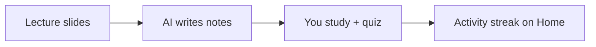

**Ocean is a study notebook that you and your AI share.** Every page is a plain Markdown file in a folder on your computer, so Claude, ChatGPT, Codex or any AI tool can read your notes and write new ones for you, and you see their changes here instantly.

> 💡 **Start here:** create a page for a course, drop the lecture slides on it, then ask your AI to write the notes. The steps are below.

## 1. Make a page for each lecture

Click **+ Add a page** in the sidebar, or type `/p` inside a page to make a sub-page. Pages inside pages work like Notion; on disk they're folders, like Obsidian.

## 2. Drop your slides on the page

Drag a lecture **PDF or PowerPoint** onto the page. Ocean turns each slide into an image (`slides/p01.jpg…`) and saves the text of every slide (`slides/slides.md`), which is what lets an AI read your lecture.

- **Slides** (top right) shows the slides beside your notes and follows the section you're reading.
- Double-click any slide, or ••• → **Open slides**, for the full-size viewer.
- **Images** turns slide pictures in the note on and off.

## 3. Let your AI write the notes

Open ••• → **Use with AI** and copy a ready-made prompt such as *Write notes from the slides* or *Add a quiz after each section*, then paste it into your AI tool. It edits the file; you watch the page fill in.

## 4. Test yourself

Every section can end with a quiz. Here's one:

```quiz
title: Check yourself — Ocean basics
Q: Where are your notes stored?
- [ ] On Ocean's servers
- [x] As Markdown files in a folder on your computer
- [ ] Inside the browser only
> Ocean is local-first: your notes are ordinary files that you own.

Q: How does an AI tool edit a page?
- [ ] Through a special plugin
- [x] By editing the page's .md file directly
- [ ] It can't
> No MCP or API needed. The rules for AI tools are in CLAUDE.md / AGENTS.md in your notes folder.
```

## 5. Everything a study note needs

Maths, written as LaTeX:

$$
P(w_i \mid w_{i-1}) = \frac{\text{count}(w_{i-1}, w_i)}{\text{count}(w_{i-1})}
$$

Diagrams, written as text:



Tables, checklists, code, images and interactive HTML explainers (`/html`) work too. Type `/` anywhere to see them all.

## Track your study

**Home** shows a study heatmap (like GitHub's) with your streak, and **Graph** shows how your pages connect.

---

Ocean is free and open source (MIT). Your notes never leave your computer unless you move them.
